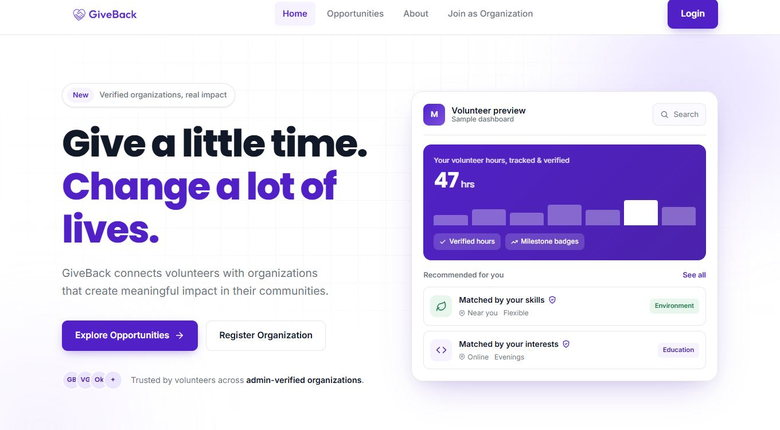
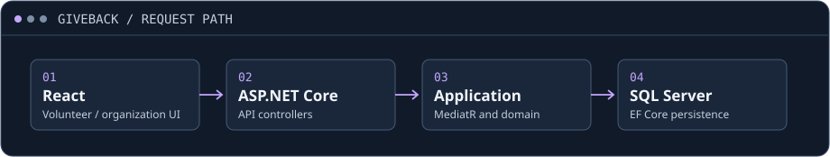

# GiveBack

**A volunteering platform · Independent full-stack university project**

Organizations publish opportunities and review applications. Volunteers discover work, apply, and log time. Organizations can verify those hours, and the backend includes certificates and impact reports.

[Live web interface ↗](https://giveback-frontend.vercel.app/) · [Architecture and data model](docs/architecture.md)

[Public React source ↗](https://github.com/INDZO/GiveBack-Source) · The API is covered by this engineering case study.

## From an opportunity to verified hours

| Volunteer | Organization |
| --- | --- |
| Explore opportunities and submit an application. | Publish opportunities and review applications. |
| Log hours against an opportunity. | Review and verify logged hours. |

## Engineering

<picture>
  <source media="(max-width: 560px)" srcset="assets/request-flow-mobile.svg">
  
</picture>

- **React** handles the web interface. **ASP.NET Core** exposes the application’s API.
- **Clean Architecture** separates the application, domain, and infrastructure layers. **MediatR** routes CQRS commands and queries to their handlers.
- **EF Core and SQL Server** store organizations, opportunities, volunteer and team applications, and hour logs. See the [conceptual model](docs/architecture.md#relational-model) for how those records connect.

I designed the relational database and built both the frontend and backend. This repository is a documentation showcase. The linked site is the public interface; the application source and runtime setup are private.
